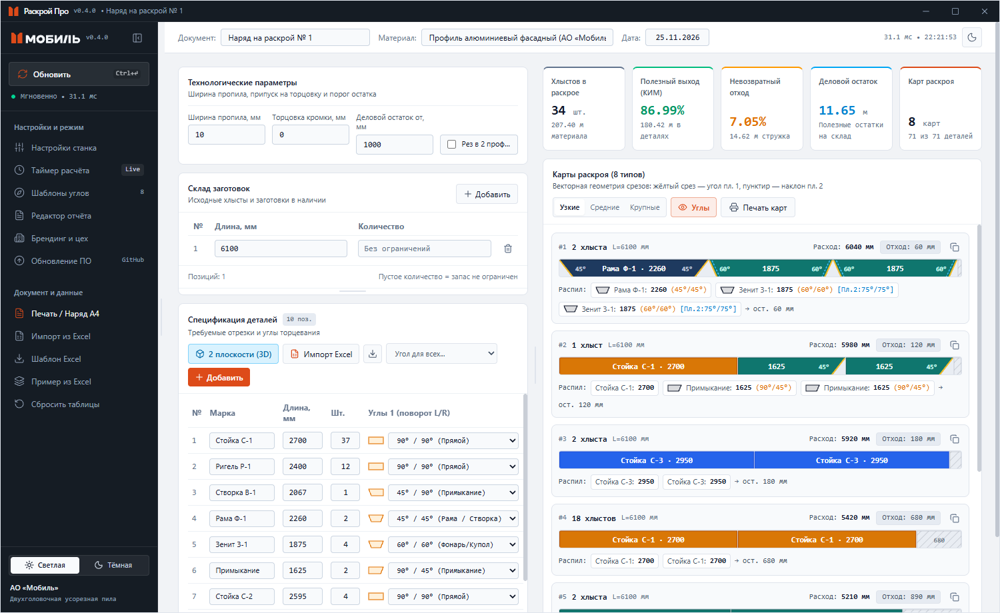
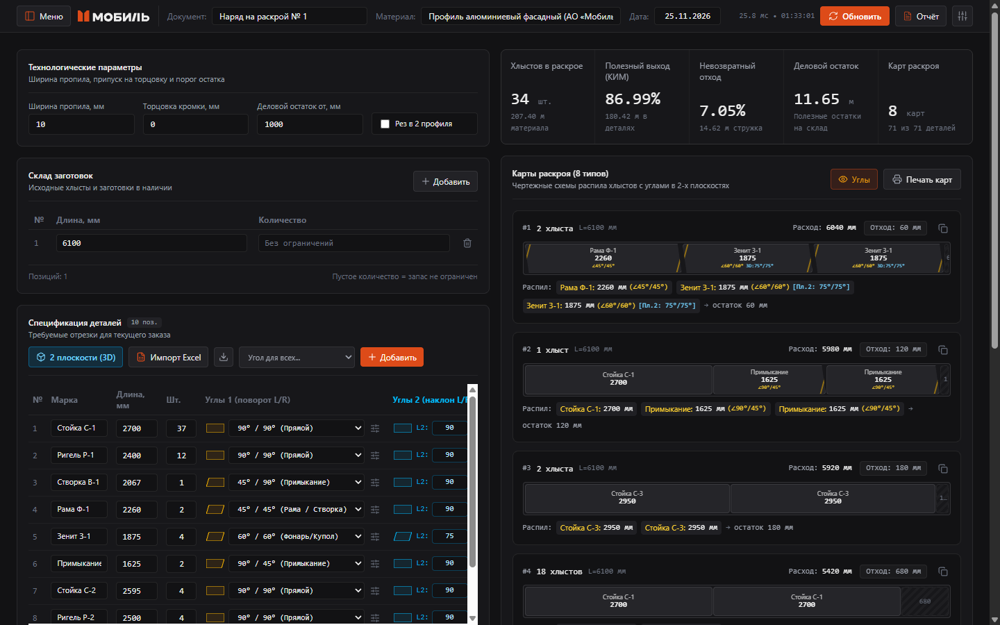

# Раскрой Про v0.3.0 — Оптимизация линейного раскроя

Десктопное приложение для оптимального одномерного (линейного) раскроя профильных и хлыстовых материалов: алюминиевого фасадного и оконного профиля, труб, металлопроката, бруса. Разработано на **Rust + Tauri v2 + React 19** с поддержкой резки под произвольными углами в двух плоскостях, импортом из Excel, автообновлением через GitHub Releases и печатью технологических карт А4 для цеха.

---

## Содержание

- [Ключевые возможности](#ключевые-возможности)
- [Интерфейс и разделы программы](#интерфейс-и-разделы-программы)
  - [1. Основное рабочее пространство](#1-основное-рабочее-пространство)
  - [2. Скрытие левой панели и работа во всю ширину](#2-скрытие-левой-панели-и-работа-во-всю-ширину)
  - [3. Настройки расчёта и таймер обновления](#3-настройки-расчёта-и-таймер-обновления)
  - [4. Конструктор шаблонов произвольных углов](#4-конструктор-шаблонов-произвольных-углов)
  - [5. Импорт спецификации деталей из Excel](#5-импорт-спецификации-деталей-из-excel)
  - [6. Встроенное обновление через GitHub Releases](#6-встроенное-обновление-через-github-releases)
- [Таблица примера импорта (Excel)](#таблица-примера-импорта-excel)
- [Пример получаемого отчёта (Наряд А4)](#пример-получаемого-отчёта-наряд-а4)
- [Архитектура и алгоритм](#архитектура-и-алгоритм)
- [Сборка, релиз и обновление](#сборка-релиз-и-обновление)
- [Отказ от ответственности и лицензия](#отказ-от-ответственности-и-лицензия)

---

## Ключевые возможности

* **Высокоточное ядро оптимизации на Rust (`raskroy-core`)**
  * Комбинация алгоритмов **динамического программирования (Knapsack DP)** и **Branch & Bound** подбирает план раскроя с максимальным коэффициентом использования материала (КИМ), минимальными отходами и наименьшим числом перенастроек пильного станка (типов карт раскроя).
  * На контрольном заказе из 71 детали (общая длина ~180.42 м) алгоритм выдаёт **34 хлыста по 6100 мм**, **86.99% КИМ**, **7.05% невозвратного отхода** и всего **8 типов карт** за единицы миллисекунд.
* **Углы торцевания в двух плоскостях (3D-рез) и произвольные градусы**
  * **Плоскость 1 (поворот стола пилы, L1 / R1):** любые углы — стандартные `90°`, `45°`, `135°`, `60°`, `22.5°` или дробные пользовательские значения (например, `33.5°`, `67.5°`).
  * **Плоскость 2 (наклон диска пилы, L2 / R2):** дополнительные углы в перпендикулярной плоскости для сложных фасадных узлов, эркеров и зенитных фонарей.
  * Визуальное отображение скосов (фасок) непосредственно на полосах карт раскроя и мини-глифы геометрии среза в таблице спецификации.
* **Гибкая левая панель и три режима расчёта**
  * Навигационная панель слева с кнопкой **полного скрытия** (`Ctrl+B`) и выезжающей **слева** панелью настроек (5 вкладок: *Таймер*, *Углы*, *Станок*, *Бренд*, *Версия*).
  * 3 режима обновления: **Мгновенно (Live)**, **По таймеру (3–60 с, по умолчанию 10 с)** с обратным отсчётом и **Вручную** (`Ctrl+Enter`).
* **Автообновление через GitHub Releases**
  * Встроенный Rust-клиент проверяет последний релиз в публичном репозитории `pururuall/raskroy-pro`, отображает заметки к версии, скачивает установщик `.exe` с прогресс-баром, проверяет заголовок файла (`MZ`) и запускает обновление.
* **Импорт из Excel (`.xlsx`, `.xls`, `.csv`)**
  * Загрузка перетаскиванием (Drag-and-Drop) с нечётким автоопределением колонок, предпросмотром распознанных деталей и режимами *«Заменить»* / *«Добавить к текущим»*.
  * Встроенная генерация готового файла-шаблона `шаблон_импорта_раскроя.xlsx`.
* **Печатный цеховой наряд-заказ (формат А4)**
  * Чёрно-белый высококонтрастный бланк с логотипом организации, названием документа, материалом, моделью станка, сводной таблицей, картами раскроя с углами обеих плоскостей и подписями исполнителя / ОТК.

---

## Интерфейс и разделы программы

### 1. Основное рабочее пространство

Слева расположено навигационное меню управления расчётом, шаблонами и документами; в центре — технологические параметры станка, склад хлыстов и таблица деталей с поддержкой маркировки и углов; справа — сводка показателей КИМ и интерактивные карты распила со скосами углов.



### 2. Скрытие левой панели и работа во всю ширину

Левая навигационная панель полностью сворачивается по кнопке или по сочетанию клавиш `Ctrl+B` — рабочая сетка занимает всю ширину экрана, а все таблицы (включая расширенный режим **«2 плоскости (3D)»** с поворотом и наклоном диска) и основные кнопки управления остаются в компактной верхней строке.



### 3. Настройки расчёта и таймер обновления

При выборе настроек из левого меню панель параметров выезжает слева поверх экрана. Вкладка **«Таймер»** позволяет выбрать режим перерасчёта (*Мгновенно*, *По таймеру* с шагом от 3 до 60 секунд, *Вручную*), автоперерасчёт при фокусе окна и показывает время последнего вычисления Rust-ядра.


### 4. Конструктор шаблонов произвольных углов

Вкладка **«Углы»** позволяет создавать, хранить и удалять собственные пресеты торцевания под нестандартные фасадные и оконные узлы (например, `33.5° / 90°`, `22.5° / 22.5°`, `60° / 60°`), которые затем мгновенно доступны в выпадающих списках таблицы деталей и пакетного назначения.


### 5. Импорт спецификации деталей из Excel

Окно импорта поддерживает `.xlsx`, `.xls` и `.csv`. После выбора или перетаскивания файла программа отображает обнаруженные столбцы, суммарный метраж и таблицу предпросмотра первых строк перед загрузкой в заказ.


### 6. Встроенное обновление через GitHub Releases

Во вкладке **«Версия»** (или по пункту **«Обновление ПО»** в левом меню) программа автоматически сверяет установленную версию с последним релизом на GitHub (`api.github.com/repos/pururuall/raskroy-pro/releases/latest`), показывает список изменений и позволяет скачать и запустить новый установщик `.exe` прямо из интерфейса.


---

## Таблица примера импорта (Excel)

Готовый эталонный файл можно скачать прямо из программы кнопкой **«Шаблон Excel»** (генерируется `шаблон_импорта_раскроя.xlsx`, также хранится в [`public/шаблон_импорта_раскроя.xlsx`](public/шаблон_импорта_раскроя.xlsx)).

| Марка / Позиция | Длина (мм) | Количество (шт) | Угол 1 левый (°) | Угол 1 правый (°) | Угол 2 доп. левый (°) | Угол 2 доп. правый (°) | Примечание |
| :--- | :---: | :---: | :---: | :---: | :---: | :---: | :--- |
| Профиль 1 | 2700 | 37 | 90 | 90 | 90 | 90 | см. чертеж "0101-3150-21" |
| Профиль 2 | 2400 | 12 | 90 | 90 | 90 | 90 | см. чертеж "0101-2555-14" |
| Профиль 3 | 2067 | 4 | 45 | 45 | 90 | 90 | см. чертеж "0101-1840-08" |
| Профиль 4 | 2260 | 2 | 135 | 90 | 85 | 90 | см. чертеж "0101-4022-03" |
| Профиль 5 | 1875 | 4 | 60 | 60 | 75 | 75 | см. чертеж "0101-5110-12" |

**Правила распознавания столбцов:**
* **Обязательные:** `Длина (мм)` (синонимы: `Длина`, `L`, `Размер`) и `Количество (шт)` (`Кол-во`, `Qty`, `Шт`).
* **Опциональные:** если колонки углов не указаны или пустые, подставляется `90°`. В файле-шаблоне также содержится второй лист *«Инструкция»* с краткой памяткой.

---

## Пример получаемого отчёта (Наряд А4)

Перед печатью или экспортом в PDF открывается интерактивное окно предпросмотра наряда, где можно на месте скорректировать название документа, материал и дату:


При печати (`window.print()` -> **Печать / В PDF**) формируется чистый документ формата **А4** с таблицей сводных показателей, картами раскроя с фасками и точными углами поворота стола и наклона диска для каждой позиции:


---

## Архитектура и алгоритм

```text
raskroy/
├── crates/
│   └── raskroy-core/          # Изолированное Rust-ядро расчёта (Knapsack DP + Branch & Bound)
├── src-tauri/
│   ├── src/
│   │   ├── lib.rs             # Tauri v2 команды и инициализация
│   │   └── updater.rs         # Rust-клиент проверки, загрузки и установки обновлений с GitHub
│   └── tauri.conf.json        # Версия, иконки и параметры Windows NSIS-бандла
├── src/
│   ├── components/
│   │   ├── LeftSidebar.tsx    # Сворачиваемое левое меню управления
│   │   ├── SettingsDrawer.tsx # Выезжающая слева панель настроек (5 вкладок)
│   │   ├── PartsTable.tsx     # Таблица деталей (марка, 2 плоскости углов, пакетное назначение)
│   │   ├── StockTable.tsx     # Склад исходных хлыстов и ограничений остатков
│   │   ├── ConfigPanel.tsx    # Пропил, торцовка, деловой остаток, режим в 2 профиля
│   │   ├── CuttingVisualizer.tsx # Схемы раскроя с фасками (clip-path) и метками углов
│   │   ├── ImportExcelModal.tsx  # Окно импорта .xlsx / .xls / .csv
│   │   ├── ReportModal.tsx    # Предпросмотр цехового наряда
│   │   ├── PrintReport.tsx    # Печатный А4-бланк для цеха
│   │   └── MobilLogo.tsx      # Векторный SVG-логотип шапки и нарядов
│   ├── utils/
│   │   └── excelImport.ts     # Парсер Excel (SheetJS) и генератор шаблона импорта
│   ├── App.tsx                # Оркестрация режимов расчёта, состояния и горячих клавиш
│   └── types.ts               # Общие TypeScript-контракты с Rust IPC
├── public/
│   └── шаблон_импорта_раскроя.xlsx
└── docs/
    └── screenshots/           # Скриншоты разделов и отчёта
```

---

## Сборка, релиз и обновление

Требования: **Node.js 20+**, **Rust (stable + cargo)**, Windows 10/11 (WebView2).

```bash
# Установка зависимостей фронтенда
npm install

# Запуск юнит- и интеграционных тестов Rust-ядра и апдейтера
cargo test

# Запуск в режиме разработки (Hot Reload + Tauri Desktop)
npm run tauri dev

# Сборка релизного Windows .exe и установщика NSIS
npm run tauri build
```

После завершения `npm run tauri build` готовые бинарные файлы с прописанными метаданными версии (`FileVersion`, `ProductVersion`) находятся в:
* Портативный исполняемый файл: `target/release/raskroy-pro.exe`
* Установщик Windows (NSIS): `target/release/bundle/nsis/Раскрой Про_0.3.0_x64-setup.exe`

### Как выпустить обновление для пользователей

1. Поднимите версию (например, `0.4.0`) в `package.json`, `src-tauri/tauri.conf.json` и `src-tauri/Cargo.toml`.
2. Выполните `npm run tauri build`.
3. Создайте новый Release в GitHub (`v0.4.0`), прикрепите собранный установщик (с именем, содержащим `setup.exe`, например `RaskroyPro_0.4.0_x64-setup.exe`) и портативный `raskroy-pro.exe`.
4. У всех пользователей при запуске или по кнопке **«Проверить обновления»** появится уведомление и кнопка установки новой версии.

---

## Отказ от ответственности и лицензия

> [!CAUTION]
> **Все права защищены (Проприетарная лицензия).** Размещение кода в открытом репозитории не означает свободного использования. Подробные юридические условия приведены в файле [LICENSE](LICENSE).

* **Запрет продажи:** продажа, перепродажа, коммерческое распространение и сублицензирование программы или её производных строго запрещены.
* **Использование только с разрешения:** использование, запуск и копирование программы допускаются **только с явного согласия правообладателя** ([pururuall](https://github.com/pururuall)).
* **Право отзыва и удаление копий:** правообладатель ([pururuall](https://github.com/pururuall)) вправе в любой момент заявить о запрете использования программы — после такого заявления любое использование должно быть немедленно прекращено, а **все копии программы** (исходный код, `.exe`, установщики и производные файлы) подлежат полному удалению.
* **Отсутствие гарантий и ответственности:** программа предоставляется **«КАК ЕСТЬ» («AS IS»)**. Автор ([pururuall](https://github.com/pururuall)) не несёт ответственности за ошибки программы, сбои расчёта, брак или порчу материала, простой оборудования, финансовые потери и любые другие убытки, возникшие при использовании или невозможности использования программы. Проверка карт раскроя и углов перед резкой лежит исключительно на пользователе.
