# Раскрой Про v0.5.0 — Оптимизация линейного раскроя

Десктопное приложение для оптимального одномерного (линейного) раскроя профильных и хлыстовых материалов: алюминиевого фасадного и оконного профиля, труб, металлопроката, бруса. Разработано на **Rust + Tauri v2 + React 19** с безрамочным интерфейсом, светлой и тёмной темами, регулируемыми панелями, векторной визуализацией углов в двух плоскостях, импортом из Excel, автообновлением через GitHub Releases, редактором отчётов и печатью технологических карт А4.

---

## Содержание

- [Ключевые возможности](#ключевые-возможности)
- [UI-референсы приложения (FigCraft)](#ui-референсы-приложения-figcraft)
  - [Общий вид приложения (Светлая, Тёмная и Режим 3D)](#общий-вид-приложения)
  - [Отдельные панели интерфейса](#отдельные-панели-интерфейса)
  - [Скрытые панели, настройки и печатная форма А4](#скрытые-панели-настройки-и-печатная-форма-а4)
- [Векторный дизайн и отдельные разделы (FigCraft UI Kit)](#векторный-дизайн-и-отдельные-разделы-figcraft-ui-kit)
- [Подробный разбор разделов](#подробный-разбор-разделов)
- [Таблица примера импорта (Excel)](#таблица-примера-импорта-excel)
- [Пример получаемого отчёта (Наряд А4)](#пример-получаемого-отчёта-наряд-а4)
- [Архитектура и алгоритм](#архитектура-и-алгоритм)
- [Сборка, релиз и обновление](#сборка-релиз-и-обновление)
- [Отказ от ответственности и лицензия](#отказ-от-ответственности-и-лицензия)

---

## Ключевые возможности

* **Высокоточное ядро оптимизации на Rust (`raskroy-core`) с выбором из 9 алгоритмов**
  * Пользователь может выбрать стратегию расчёта в **Настройки → «Алгоритм»** (или кликом по кнопке активного алгоритма над картами) с подробным описанием **«Как считает»** и **«Когда выбирать»**:
    * **Автоподбор (Комбинированный)** — параллельно запускает все 7 стратегий и автоматически выбирает лучший план (`детали → хлысты → отход → число карт`).
    * **Метод генерации столбцов (Gilmore–Gomory / ЦЛП)** — решает непрерывную ЛП-релаксацию двухфазным симплекс-методом и догенерирует карты через задачу о рюкзаке.
    * **Метод ветвей и границ (Branch & Bound)** — направленный поиск по дереву ЦЛП с отсечением ветвей по нижней оценке и исключением симметрий (с защитным лимитом узлов).
    * **Динамическое программирование (`Knapsack DP` и `Knapsack DP с допуском`)** — точная целочисленная упаковка хлыстов.
    * **Имитация отжига + локальный поиск (`SA`)** — метаэвристика (`Swap`, `Relocate`, `2-Opt`, переключение `Best/First Fit`) для сложных складов и снижения невозвратного отхода.
    * **Минимум перенастроек станка** — минимизирует число уникальных карт распила для серийного производства.
    * **Жадные стратегии (`Best Fit Decreasing` и `First Fit Decreasing`)** — сверхбыстрая классическая раскладка.
  * На контрольном заказе из 71 детали (общая длина ~180.42 м) алгоритм выдаёт **34 хлыста по 6100 мм**, **86.99% КИМ**, **7.05% невозвратного отхода** и всего **8 типов карт** (~39 мс), а режим `SA` при необходимости снижает невозвратный отход до **5.00%** за счёт увеличения делового остатка.
* **Современный безрамочный интерфейс, две темы и регулируемые панели**
  * Убрана стандартная системная рамка окна — добавлена компактная перетаскиваемая шапка с кнопками управления окном (`Свернуть`, `Развернуть`, `Закрыть`).
  * **Светлая тема (по умолчанию)** и **Тёмная графитовая тема** переключаются в один клик в шапке или левом меню.
  * Все ключевые области имеют перетягиваемые разделители (двойной клик сбрасывает пропорции): ширина бокового меню, соотношение ширины таблиц и визуализатора, а также высота таблиц и списка карт распила.
* **Векторная геометрия резов (SVG) и углы в двух плоскостях (3D-рез)**
  * Полосы карт распила отрисовываются в точном масштабе векторными многоугольниками с наглядными скосами фасок, подсветкой углов поворота стола (**Плоскость 1: L1/R1** — включая дробные градусы вроде `33.5°`, `67.5°`) и пунктирным обозначением наклона диска (**Плоскость 2: L2/R2**).
  * Доступны три высоты полос (`Узкие` по умолчанию, `Средние`, `Крупные`) и кнопка скрытия/показа градусов прямо на схеме.
* **Редактор отображения отчётов (А4) + Печать без смещений**
  * Встроенный визуальный редактор отчётов в настройках (с живым мини-макетом А4) позволяет включать/отключать логотип и реквизиты, таблицу КИМ, схемы полос, подписи марок деталей, градусы углов, перечень резов, компактные карточки, блок примечаний для цеха и подписи исполнителей.
  * На печатной карте отрезки начинаются строго от края хлыста без паразитных отступов и корректно отображают зоны торцовки.
* **Гибкая левая панель и три режима расчёта**
  * Боковое меню с полным сворачиванием (`Ctrl+B`) и выезжающая слева панель настроек с 6 вкладками (*Таймер*, *Углы*, *Алгоритм*, *Отчёт*, *Вид*, *Версия*).
  * 3 режима перерасчёта: **Мгновенно (Live)**, **По таймеру (3–60 с)** и **Вручную** (`Ctrl+Enter`).
* **Автообновление через GitHub Releases**
  * Встроенный Rust-клиент проверяет `releases/latest` в публичном репозитории `pururuall/raskroy-pro`, отображает заметки к версии, скачивает установщик `.exe` с прогресс-баром, проверяет заголовок файла (`MZ`) и запускает обновление.
* **Импорт из Excel (`.xlsx`, `.xls`, `.csv`)**
  * Загрузка перетаскиванием с нечётким автоопределением столбцов и генерацией эталонного файла `шаблон_импорта_раскроя.xlsx`.

---

## UI-референсы приложения (FigCraft)

Комплексные дизайн-референсы приложения (подготовлены и экспортированы из FigCraft, актуально для ветки **v0.4.0–v0.5.0**):

### Общий вид приложения


### Отдельные панели интерфейса

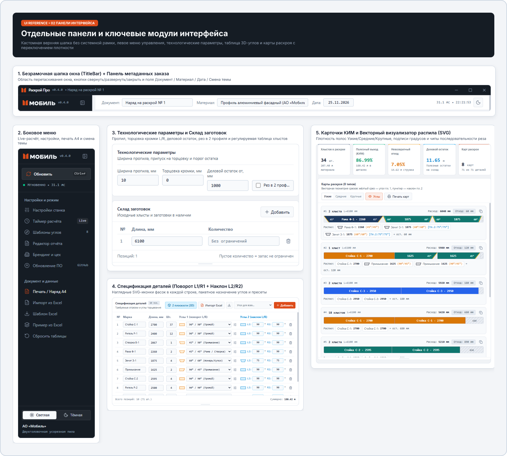

### Скрытые панели, настройки и печатная форма А4


---

## Векторный дизайн и отдельные разделы (FigCraft UI Kit)

Исходный векторный макет всех экранов и компонентов сохранён в репозитории: [`docs/design/raskroy_pro_vector_ui.figcraft`](docs/design/raskroy_pro_vector_ui.figcraft) (`0` растровых вставок — 100% редактируемые векторные слои и авто-лейаут).

### Основные области рабочего интерфейса (вектор)

**Безрамочная шапка (TitleBar) и панель документа (развёрнутое / скрытое меню):**

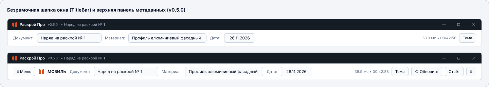

| Левое навигационное меню | Параметры станка и Склад заготовок |
| :---: | :---: |
| 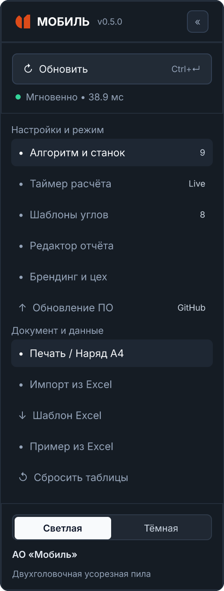 | <br><br> |

**Спецификация деталей (все 10 позиций в 2 плоскостях 3D):**

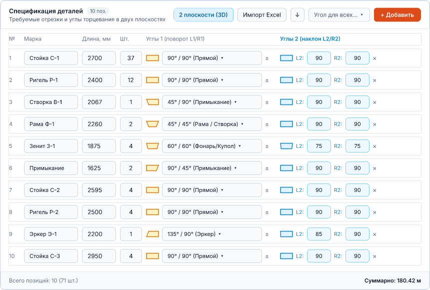

**Сводные показатели КИМ и все 8 карт распила с фасками (SVG):**

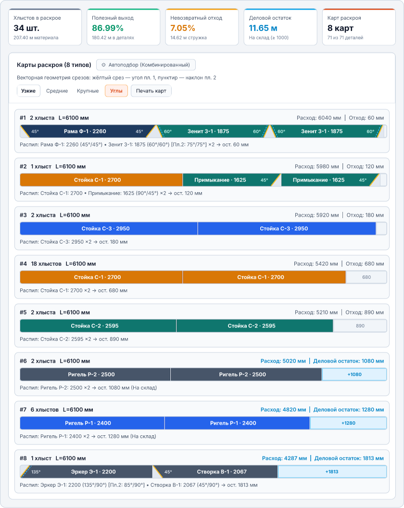

### Скрытые выезжающие панели настроек, импорт и наряд А4 (вектор)

| Выбор алгоритма раскроя (9 режимов) | Алгоритмы и сравнение КИМ |
| :---: | :---: |
| 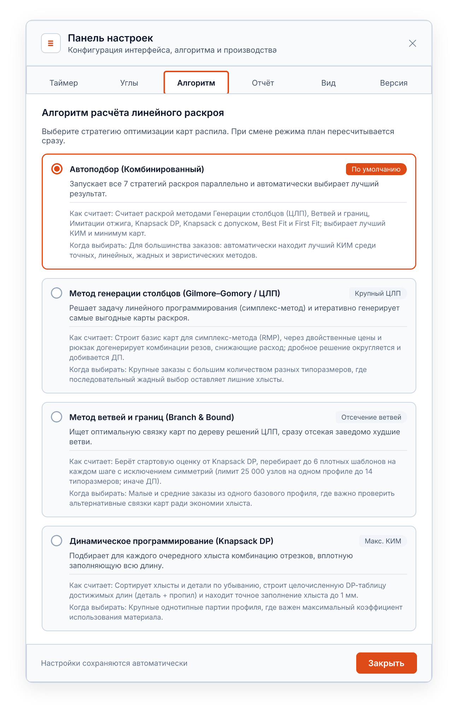 | 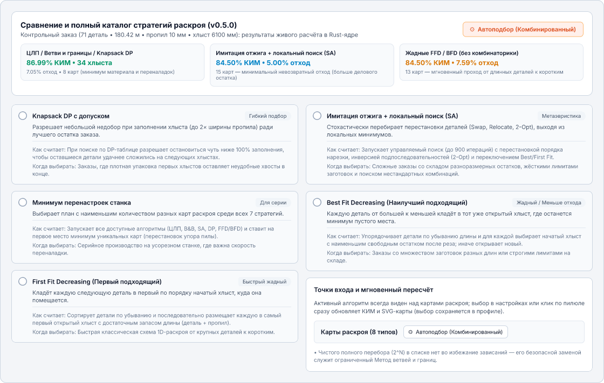 |

| Таймер расчёта | Конструктор углов | Настройки станка (вкладка Алгоритм) |
| :---: | :---: | :---: |
| 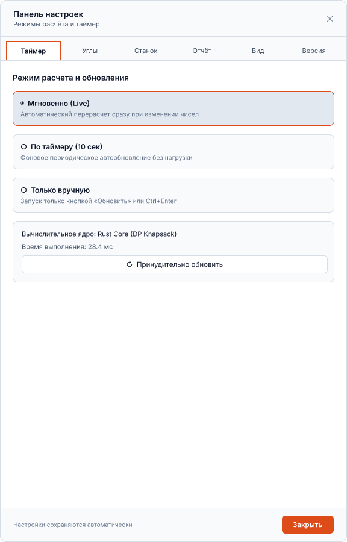 | 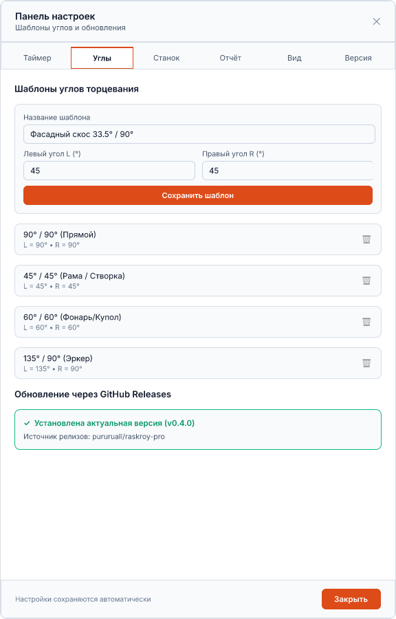 |  |

| Редактор отчётов (А4) | Вид и реквизиты | Обновление ПО (GitHub) |
| :---: | :---: | :---: |
| 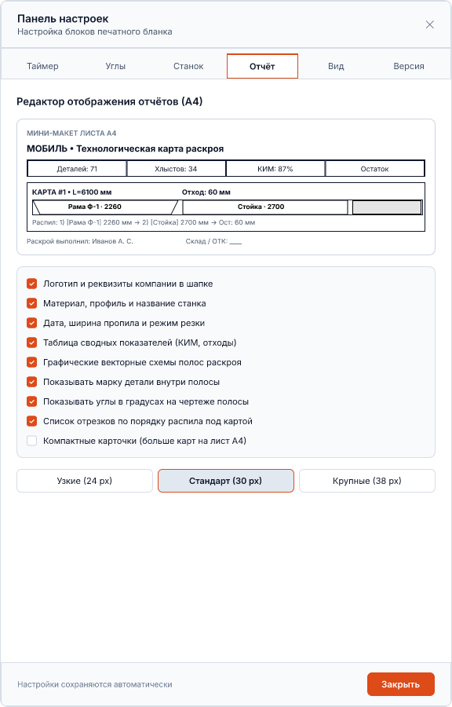 | 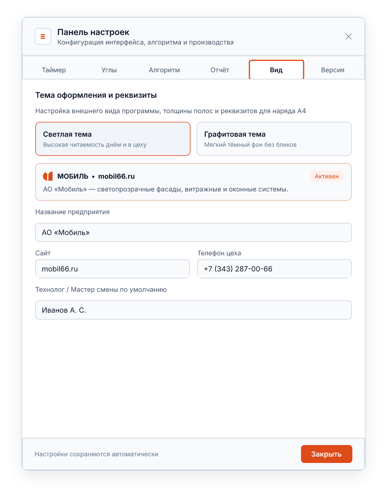 | 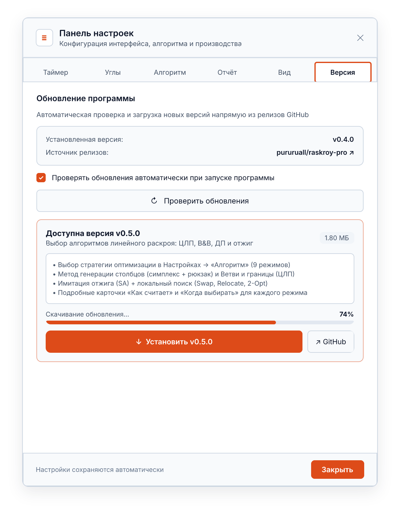 |

| Импорт из Excel | Печатный наряд А4 (вектор от края хлыста) |
| :---: | :---: |
|  | 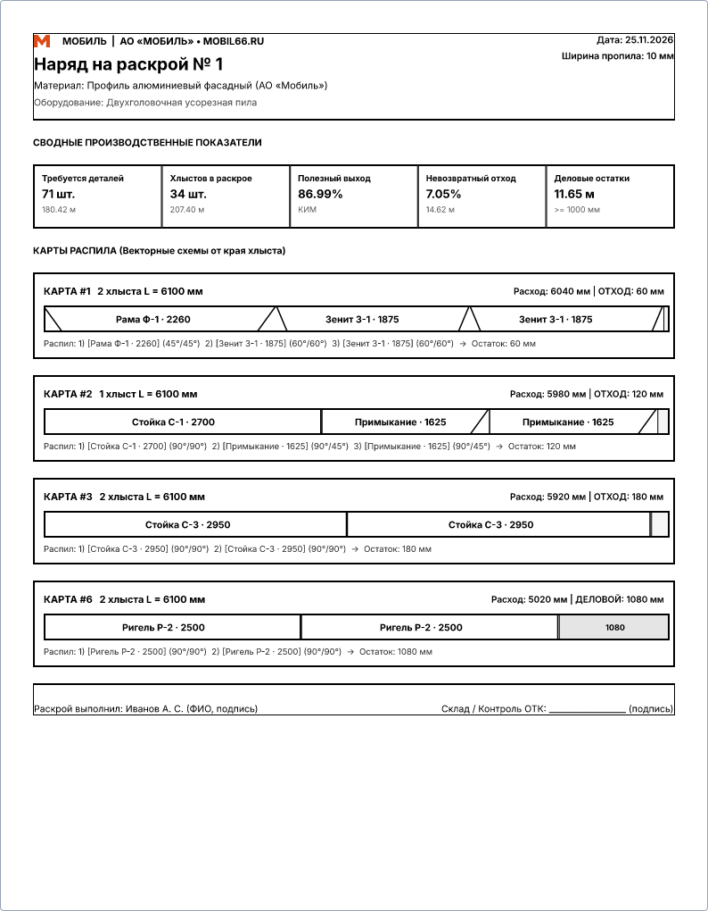 |

---

## Подробный разбор разделов

### 1. Основное рабочее пространство (Светлая и Тёмная темы)

Слева расположено регулируемое по ширине меню управления; в центре — технологические параметры станка, склад заготовок и спецификация деталей; справа — сводные карточки КИМ и векторные SVG-карты распила со скосами углов.


<details>
<summary>Посмотреть интерфейс в тёмной графитовой теме</summary>

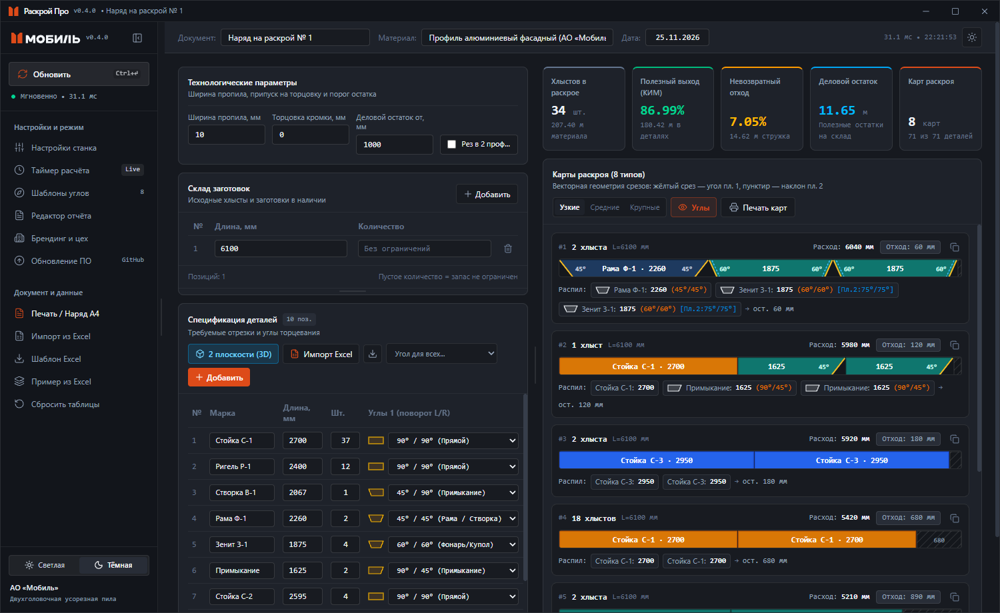

</details>

### 2. Скрытие левой панели и режим «2 плоскости (3D)»

Левое меню полностью скрывается по кнопке или по сочетанию клавиш `Ctrl+B`, освобождая место для широкой таблицы деталей с двумя плоскостями углов (поворот стола `L1/R1` и наклон диска `L2/R2`).


### 3. Настройки расчёта и таймер обновления

Выезжающая слева панель настроек — вкладка **«Таймер»** переключает *Мгновенный*, *Таймерный (3–60 с)* и *Ручной* режимы расчёта, а также показывает время выполнения Rust-ядра.


### 4. Конструктор шаблонов произвольных углов

Вкладка **«Углы»** хранит пользовательские пресеты торцевания для нестандартных узлов (например, `33.5° / 90°`, `60° / 60°`, `135° / 90°`), доступные прямо в выпадающих списках таблицы деталей.

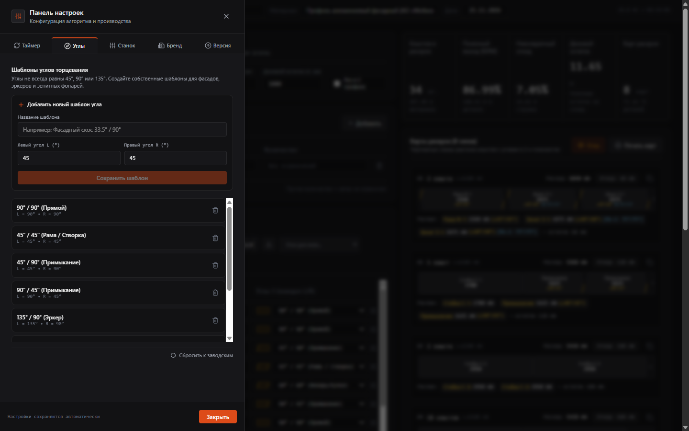

### 5. Редактор отображения отчётов (А4)

Вкладка **«Отчёт»** (открывается также по кнопке *«Настроить отчёт»* из окна предпросмотра А4) включает интерактивный мини-макет листа, управление видимостью всех секций отчёта, выбор толщины полос и ввод цеховых примечаний.

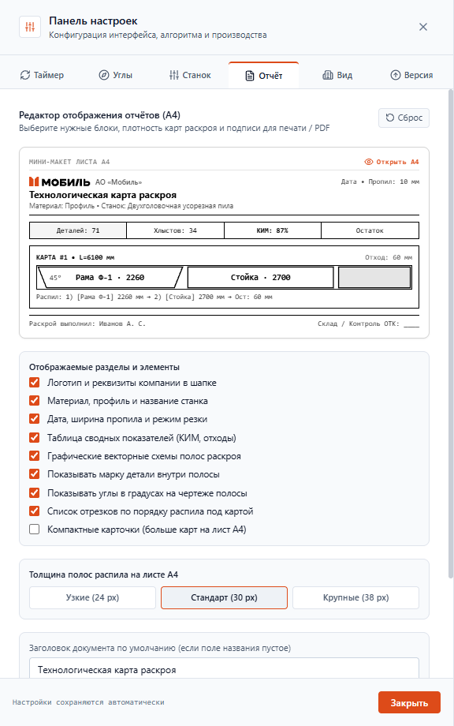

### 6. Импорт спецификации деталей из Excel

Окно импорта (`.xlsx`, `.xls`, `.csv`) автоматически распознаёт колонки и углы в двух плоскостях и позволяет скачать эталонный шаблон перед загрузкой.


### 7. Встроенное обновление через GitHub Releases

Во вкладке **«Версия»** программа сравнивает установленную версию с последним релизом на GitHub (`api.github.com/repos/pururuall/raskroy-pro/releases/latest`), скачивает установщик и запускает обновление в один клик.


### 8. Выбор и сравнение алгоритмов линейного раскроя (v0.5.0)

Во вкладке **«Алгоритм»** (открывается из меню **«Алгоритм и станок»** или кликом по кнопке активного режима над картами раскроя) доступны **9 режимов**: **Автоподбор (Комбинированный)** по умолчанию, **Метод генерации столбцов (Gilmore–Gomory / ЦЛП)**, **Метод ветвей и границ (Branch & Bound)**, **Knapsack DP**, **Knapsack DP с допуском**, **Имитация отжига + локальный поиск (SA)**, **Минимум перенастроек станка**, **Best Fit Decreasing** и **First Fit Decreasing**.

Для каждого режима прямо в интерфейсе приведены пояснения *«Как считает»* и *«Когда выбирать»*, а при переключении план и КИМ пересчитываются мгновенно. Нативный наивный полный перебор намеренно не используется (во избежание зависаний из-за комбинаторного взрыва) — его быстрой и безопасной заменой служит ограниченный поиск **Branch & Bound**.

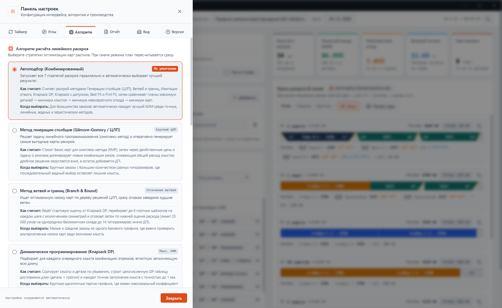

---

## Таблица примера импорта (Excel)

Готовый эталонный файл можно скачать кнопкой **«Шаблон Excel»** в программе (`шаблон_импорта_раскроя.xlsx`, также хранится в [`public/шаблон_импорта_раскроя.xlsx`](public/шаблон_импорта_раскроя.xlsx)).

| Марка / Позиция | Длина (мм) | Количество (шт) | Угол 1 левый (°) | Угол 1 правый (°) | Угол 2 доп. левый (°) | Угол 2 доп. правый (°) | Примечание |
| :--- | :---: | :---: | :---: | :---: | :---: | :---: | :--- |
| Профиль 1 | 2700 | 37 | 90 | 90 | 90 | 90 | см. чертеж "0101-3150-21" |
| Профиль 2 | 2400 | 12 | 90 | 90 | 90 | 90 | см. чертеж "0101-2555-14" |
| Профиль 3 | 2067 | 4 | 45 | 45 | 90 | 90 | см. чертеж "0101-1840-08" |
| Профиль 4 | 2260 | 2 | 135 | 90 | 85 | 90 | см. чертеж "0101-4022-03" |
| Профиль 5 | 1875 | 4 | 60 | 60 | 75 | 75 | см. чертеж "0101-5110-12" |

**Правила распознавания столбцов:**
* **Обязательные:** `Длина (мм)` (синонимы: `Длина`, `L`, `Размер`) и `Количество (шт)` (`Кол-во`, `Qty`, `Шт`).
* **Опциональные:** если колонки углов не указаны или пустые, подставляется `90°`. В файле-шаблоне также содержится второй лист *«Инструкция»* с краткой памяткой.

---

## Пример получаемого отчёта (Наряд А4)

Перед печатью открывается предпросмотр с настраиваемыми заголовком, материалом, датой и быстрым переходом в редактор отчётов:


При печати (`Печать / В PDF`) формируется чистый документ формата **А4** с точными векторными картами от начала каждого хлыста:


---

## Архитектура и алгоритм

```text
raskroy/
├── crates/
│   └── raskroy-core/             # Изолированное Rust-ядро расчёта (lib.rs: ДП/FFD/BFD; advanced.rs: ЦЛП/B&B/SA)
├── src-tauri/
│   ├── src/
│   │   ├── lib.rs                # Tauri v2 команды и инициализация
│   │   └── updater.rs            # Rust-клиент проверки, загрузки и установки обновлений с GitHub
│   ├── capabilities/default.json # Разрешения безрамочного окна Tauri v2
│   └── tauri.conf.json           # Конфигурация безрамочного окна, версия и NSIS-бандл
├── src/
│   ├── components/
│   │   ├── TitleBar.tsx          # Кастомная безрамочная шапка с кнопками управления окном
│   │   ├── ResizeHandle.tsx      # Перетягиваемые разделители ширины и высоты панелей
│   │   ├── LeftSidebar.tsx       # Сворачиваемое левое меню управления и переключения тем
│   │   ├── SettingsDrawer.tsx    # Выезжающая панель настроек (6 вкладок + редактор отчётов)
│   │   ├── PartsTable.tsx        # Таблица деталей (марка, 2 плоскости углов, пакетное назначение)
│   │   ├── StockTable.tsx        # Склад исходных хлыстов и ограничений остатков
│   │   ├── ConfigPanel.tsx       # Пропил, торцовка, деловой остаток, режим в 2 профиля
│   │   ├── CuttingVisualizer.tsx # Векторные SVG-схемы раскроя с фасками и плотностями полос
│   │   ├── ImportExcelModal.tsx  # Окно импорта .xlsx / .xls / .csv
│   │   ├── ReportModal.tsx       # Предпросмотр цехового наряда А4
│   │   ├── PrintReport.tsx       # Печатный А4-бланк с поддержкой редактора отображения
│   │   └── Logo / Brand          # Векторный SVG-логотип шапки и нарядов
│   ├── utils/
│   │   └── excelImport.ts        # Парсер Excel (SheetJS) и генератор шаблона импорта
│   ├── App.tsx                   # Оркестрация режимов расчёта, тем, ресайза и горячих клавиш
│   └── types.ts                  # TypeScript-контракты с Rust IPC и схема настроек отчётов
├── public/
│   └── шаблон_импорта_раскроя.xlsx
└── docs/
    ├── design/
    │   └── raskroy_pro_vector_ui.figcraft # 100% векторный макет всех разделов UI (FigCraft)
    └── screenshots/
        ├── vector/                        # Экспорт отдельных векторных разделов из FigCraft
        └── *.png                          # UI-референсы и скриншоты v0.4.0–v0.5.0
```

---

## Сборка, релиз и обновление

Требования: **Node.js 20+**, **Rust (stable + cargo)**, Windows 10/11 (WebView2).

```bash
# Установка зависимостей фронтенда
npm install

# Запуск юнит- и интеграционных тестов Rust-ядра и апдейтера
cargo test --workspace

# Запуск в режиме разработки (Hot Reload + Tauri Desktop)
npm run tauri dev

# Сборка релизного Windows .exe и установщика NSIS
npm run tauri build
```

После завершения `npm run tauri build` готовые бинарные файлы с прописанными метаданными версии (`FileVersion`, `ProductVersion`) находятся в:
* Портативный исполняемый файл: `target/release/raskroy-pro.exe`
* Установщик Windows (NSIS): `target/release/bundle/nsis/Раскрой Про_0.5.0_x64-setup.exe`

---

## Отказ от ответственности и лицензия

> [!CAUTION]
> **Все права защищены (Проприетарная лицензия).** Размещение кода в открытом репозитории не означает свободного использования. Подробные юридические условия приведены в файле [LICENSE](LICENSE).

* **Запрет продажи:** продажа, перепродажа, коммерческое распространение и сублицензирование программы или её производных строго запрещены.
* **Использование только с разрешения:** использование, запуск и копирование программы допускаются **только с явного согласия правообладателя** ([pururuall](https://github.com/pururuall)).
* **Право отзыва и удаление копий:** правообладатель ([pururuall](https://github.com/pururuall)) вправе в любой момент заявить о запрете использования программы — после такого заявления любое использование должно быть немедленно прекращено, а **все копии программы** (исходный код, `.exe`, установщики и производные файлы) подлежат полному удалению.
* **Отсутствие гарантий и ответственности:** программа предоставляется **«КАК ЕСТЬ» («AS IS»)**. Автор ([pururuall](https://github.com/pururuall)) не несёт ответственности за ошибки программы, сбои расчёта, брак или порчу материала, простой оборудования, финансовые потери и любые другие убытки, возникшие при использовании или невозможности использования программы. Проверка карт раскроя и углов перед резкой лежит исключительно на пользователе.
