# Раскрой Про v0.6.0 — Оптимизация линейного раскроя

Десктопное приложение для оптимального одномерного (линейного) раскроя профильных и хлыстовых материалов: алюминиевого фасадного и оконного профиля, труб, металлопроката, бруса. Разработано на **Rust + Tauri v2 + React 19** с многовкладочным рабочим пространством по материалам и цветам RAL, 4 темами оформления, сгруппированными настройками, умным расходом обрезков со склада, пакетной печатью нарядов А4, импортом САПР-выгрузок (`CSV`/`Excel`), векторной геометрией углов в двух плоскостях и автообновлением через GitHub Releases.

---

## Содержание

- [Что нового в v0.6.0](#что-нового-в-v060)
- [Ключевые возможности](#ключевые-возможности)
- [Скриншоты v0.6.0](#скриншоты-v060)
- [UI-референсы и векторный макет (FigCraft)](#ui-референсы-и-векторный-макет-figcraft)
- [Таблица примера импорта (Excel / CSV)](#таблица-примера-импорта-excel--csv)
- [Архитектура проекта](#архитектура-проекта)
- [Сборка, релиз и обновление](#сборка-релиз-и-обновление)
- [Отказ от ответственности и лицензия](#отказ-от-ответственности-и-лицензия)

---

## Что нового в v0.6.0

* **Стартовый экран без боковой панели и работа с нуля:**
  * При открытии программы пользователя встречает чистый стартовый экран с двумя карточками: **«Загрузить файл / Импорт»** (подсказка *«Перетащите файл или выберите файл»* при наведении) и **«Начать с нуля»** (подсказка *«Начать вручную»*).
  * Ручной режим открывает полностью пустую рабочую область без предустановленных демо-данных.
* **Многовкладочный режим по материалам и цветам (`Article + RAL`):**
  * Загрузка выгрузки САПР автоматически раскладывает позиции по отдельным вкладкам (`40.0101 · RAL 7012`, `AYPC.EF100.0501 · RAL 7012`, `RAL 7001` и т. д.) с цветовым индикатором RAL, счётчиком/КИМ на каждой вкладке и поповером **«Сводка (N)»**.
  * Полоса вкладок не показывает системный скроллбар — при переполнении появляются аккуратные кнопки прокрутки **`<`** и **`>`**, работает прокрутка колесом мыши и `Ctrl+T` для новой вкладки.
* **Скрытая по умолчанию боковая панель с закреплением (`Pin`):**
  * Боковое меню по умолчанию скрыто (открывается кнопкой **«Меню»** или `Ctrl+B`), содержит только частые действия (`Обновить`, `Новая вкладка`, `Загрузить / Импорт`, `Печать / Наряд А4`, `Очистить вкладку`, `Настройки`) и может быть зафиксировано канцелярской кнопкой (`Pin`).
* **Отдельное окно настроек по группам + 4 темы интерфейса:**
  * Настройки перенесены в отдельную двухколоночную область с навигацией по 8 группам (*Алгоритм раскроя*, *Станок и расчёт*, *Углы и шаблоны*, *Импорт CSV / Excel*, *Печать и отчёт А4*, *Темы*, *Брендинг и цех*, *Обновления и о ПО*).
  * Доступны **4 темы оформления**: **Светлая классическая**, **Сталь и индиго (CAD)**, **Тёмная графитовая** и **Тёмный изумруд (Контраст)**.
* **Приоритет обрезков и экономия погонажа в ядре Rust (`raskroy-core`):**
  * В таблице **«Склад заготовок»** появилась кнопка **`+ Обрезок`** и переключатель **`Обрезок / Целый`** для каждой строки.
  * В параметрах и настройках доступны 3 стратегии работы склада: **«Экономия метража и обрезков»** (по умолчанию), **«Строго обрезки в 1-ю очередь»** и **«Минимум хлыстов (длинные сначала)»**.
  * Новый мультихлыстовой оптимизатор (`solve_multi_stock_knapsack`) на смешанном складе (например, `6000 мм` + `3200 мм × 20` + `2500 мм`) автоматически использует подходящие короткие хлысты (`3200 мм` под деталь `3126 мм`), сокращая расход профиля с `120.00 м` (КИМ `75.58%`) до **`94.00 м`** (КИМ **`96.49%`**).
* **Пакетная печать всех вкладок на формат А4:**
  * Из окна **«Сводка (N)»** и в предпросмотре наряда А4 добавлен режим **«Все вкладки (N)»** для печати или сохранения в PDF всех рассчитанных вкладок по очереди с разрывами страниц.
* **Улучшенный парсер САПР CSV / Excel + заготовка по умолчанию `6000 мм`:**
  * Корректно читает CSV (`UTF-8` / `Windows-1251`, BOM, разделители `;` и `,`) с десятичными запятыми (`3112,5 → 3113 мм` с округлением вверх), распознаёт `Article Number`, `Lenght`, `Quantity`, `Colour`, `Primery Angles 1/2`, `Secondary Angles 1/2`, объединяет дубликаты строк и подставляет длину хлыста по умолчанию **`6000 мм`** (настраивается в **Настройки → Импорт CSV / Excel**).
* **Исправления настольного окна Windows:**
  * Исправлен нативный drag-and-drop файлов из Проводника (`dragDropEnabled: false`) и убрана белая обводка вокруг безрамочного окна.

---

## Ключевые возможности

* **Высокоточное ядро оптимизации на Rust (`raskroy-core`) с выбором из 9 алгоритмов**
  * В разделе **Настройки → «Алгоритм раскроя»** (или кликом по кнопке активного алгоритма над картами) доступны **9 стратегий** с карточками *«Как считает»* и *«Когда выбирать»*:
    * **Автоподбор (Комбинированный)** — параллельно запускает все стратегии расчёта (включая мультихлыстовой рюкзак и отбор остатков) и автоматически выбирает оптимальный план.
    * **Метод генерации столбцов (Gilmore–Gomory / ЦЛП)** — решает непрерывную ЛП-релаксацию двухфазным симплекс-методом и догенерирует карты через задачу о рюкзаке.
    * **Метод ветвей и границ (Branch & Bound)** — направленный поиск по дереву ЦЛП с отсечением ветвей и исключением симметрий.
    * **Динамическое программирование (`Knapsack DP` и `Knapsack DP с допуском`)** — целочисленная упаковка хлыстов с точностью до `1 мм`.
    * **Имитация отжига + локальный поиск (`SA`)** — метаэвристика (`Swap`, `Relocate`, `2-Opt`, переключение `Best/First Fit`) с учётом приоритета обрезков и суммарного метража.
    * **Минимум перенастроек станка** — минимизирует число уникальных карт распила для серийного производства.
    * **Жадные стратегии (`Best Fit Decreasing` и `First Fit Decreasing`)** — быстрая классическая раскладка с учётом приоритета склада.
* **Векторная геометрия резов (SVG) и углы в двух плоскостях (3D-рез)**
  * Полосы карт распила отрисовываются в точном масштабе с наглядными скосами фасок, углами поворота стола (**Плоскость 1: L1/R1**, включая дробные углы) и пунктирным обозначением наклона диска (**Плоскость 2: L2/R2**).
* **Редактор отображения отчётов (А4) и пакетная печать**
  * Визуальный редактор наряда А4 с настройкой логотипа, таблицы КИМ, схем, градусов, примечаний цеха и подписей, плюс печать как текущей вкладки, так и всех открытых вкладок сразу.
* **Автообновление через GitHub Releases**
  * Встроенный Rust-клиент проверяет `releases/latest` в публичном репозитории `pururuall/raskroy-pro`, отображает заметки к версии, скачивает установщик `.exe` с прогресс-баром, проверяет заголовок файла (`MZ`) и запускает обновление.

---

## Скриншоты v0.6.0

### Стартовый экран и импорт из САПР / Excel

| Стартовый экран (без боковой панели) | Загрузка CSV/Excel по материалам и цветам RAL |
| :---: | :---: |
| 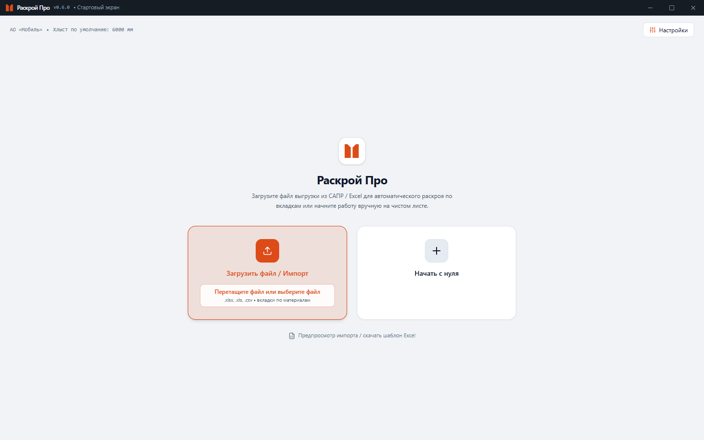 | 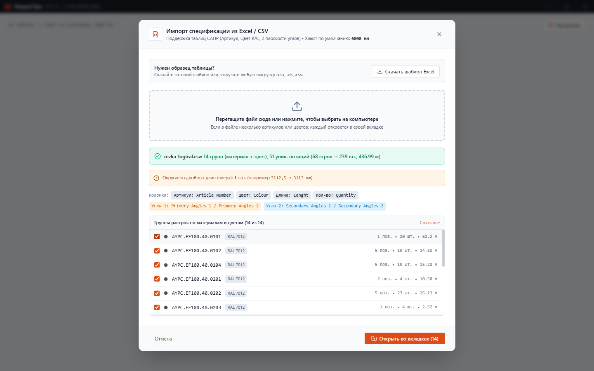 |

### Вкладки с навигацией `<` / `>` и приоритет обрезков

Вкладки прокручиваются кнопками `<` / `>` без системного скроллбара; строка `3200 мм × 20 (Обрезок)` автоматически срабатывается на детали `3126 мм`, поднимая КИМ до **96.49%** и экономя **26 м** профиля по сравнению с резкой из 6-метровых хлыстов:

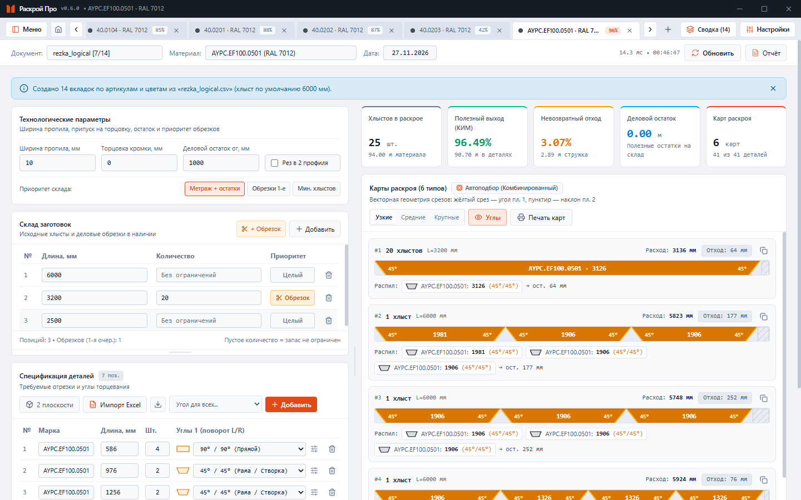

### Сгруппированные настройки, выбор тем и приоритет склада

| Темы интерфейса (4 палитры) | Параметры станка и приоритет обрезков | Закрепляемая боковая панель (`Pin`) |
| :---: | :---: | :---: |
| 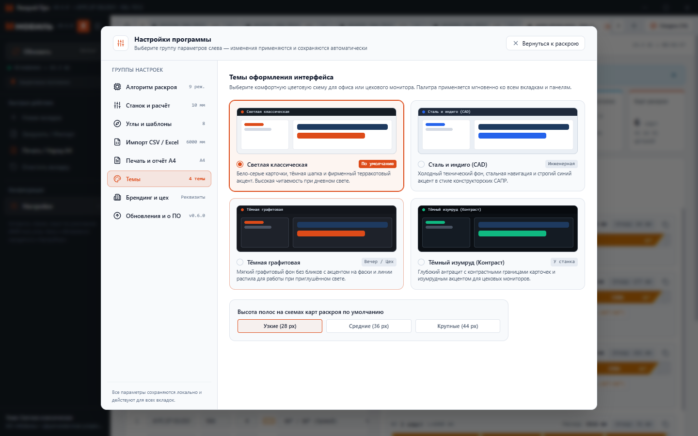 | 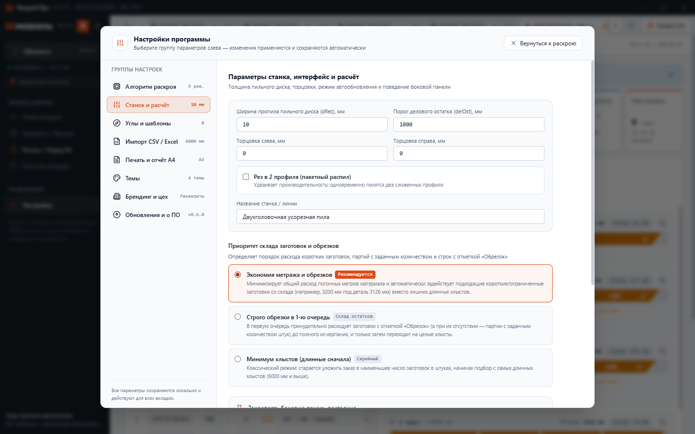 | 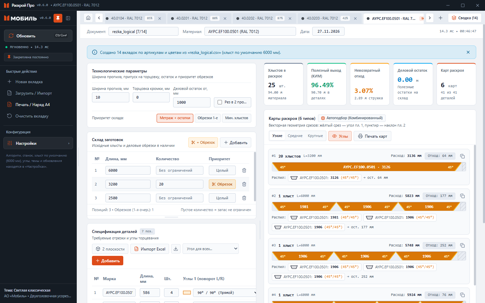 |

### Тема «Сталь и индиго (CAD)», «Тёмный изумруд» и пакетная печать А4

| Тема «Сталь и индиго (CAD)» | Тема «Тёмный изумруд (Контраст)» |
| :---: | :---: |
| 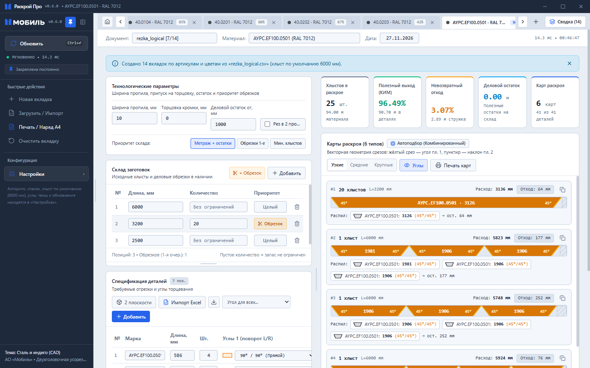 | 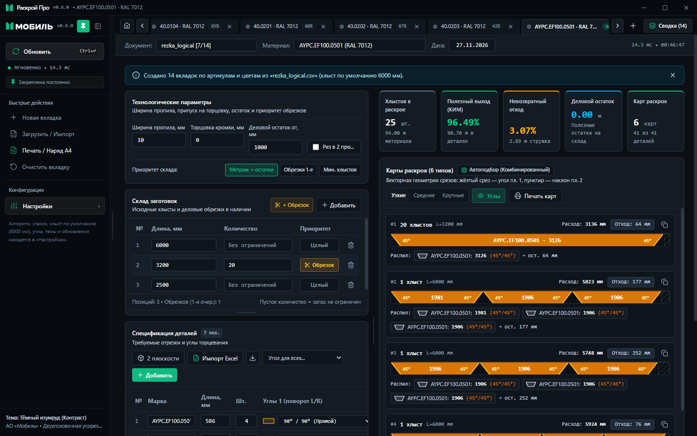 |

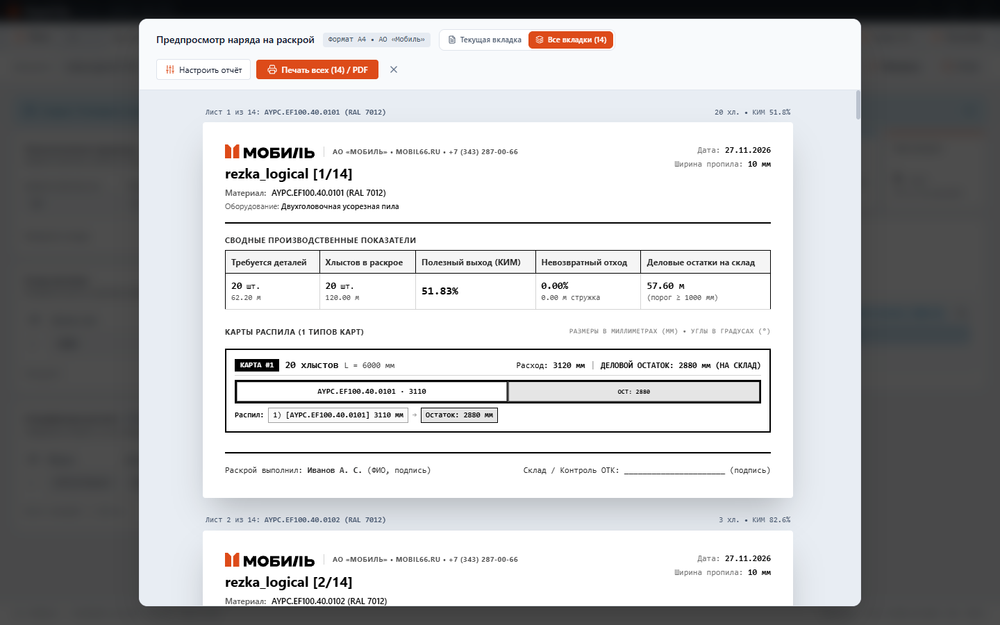

---

## UI-референсы и векторный макет (FigCraft)

* Концепция редизайна и все экраны **v0.6.0** в векторном формате FigCraft: [`docs/design/raskroy_v060_ui.figcraft`](docs/design/raskroy_v060_ui.figcraft).
* Векторный UI-кит и отдельные разделы ветки **v0.4.0–v0.5.0**: [`docs/design/raskroy_pro_vector_ui.figcraft`](docs/design/raskroy_pro_vector_ui.figcraft).

<details>
<summary>Предыдущие UI-референсы и векторные разделы (v0.4.0–v0.5.0)</summary>

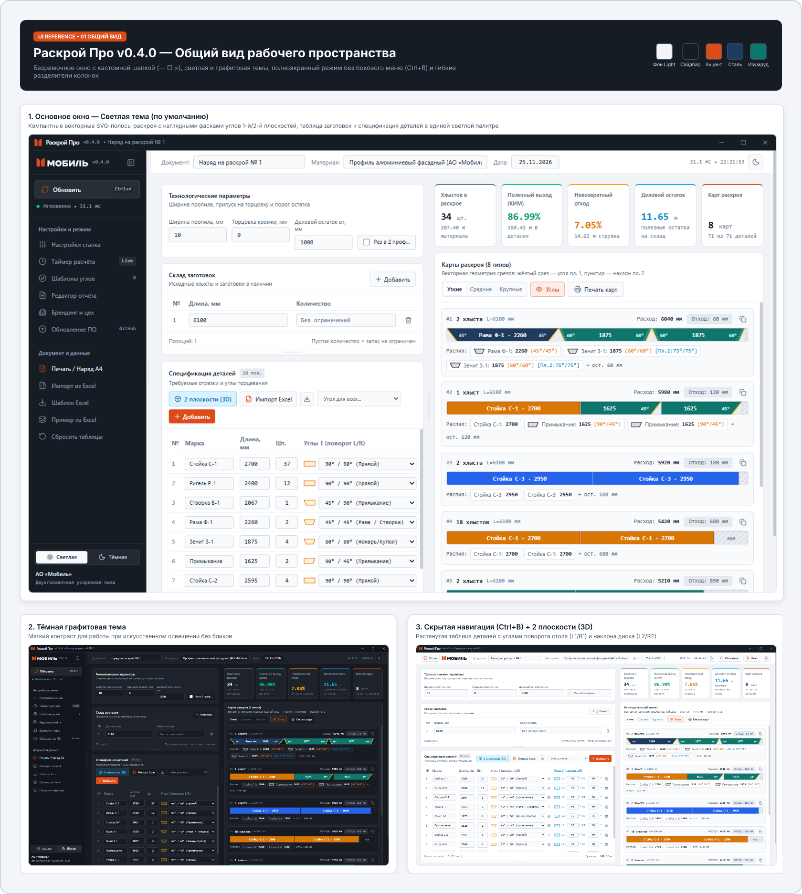

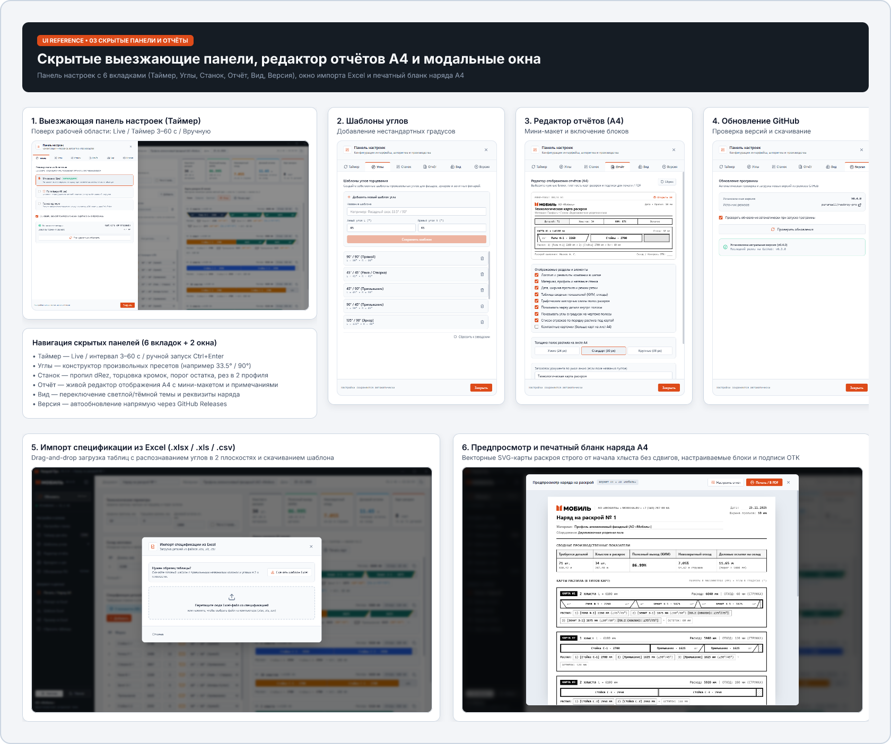

</details>

---

## Таблица примера импорта (Excel / CSV)

Готовый эталонный файл можно скачать в **Настройки → «Импорт CSV / Excel» → «Скачать шаблон Excel»** (`шаблон_импорта_раскроя.xlsx`, также хранится в [`public/шаблон_импорта_раскроя.xlsx`](public/шаблон_импорта_раскроя.xlsx)).

| Article Number / Марка | Lenght / Длина (мм) | Quantity / Кол-во | Colour | Primery Angles 1/2 (°) | Secondary Angles 1/2 (°) |
| :--- | :---: | :---: | :---: | :---: | :---: |
| AYPC.EF100.0501 | 3126 | 20 | RAL 7012 | 45 / 45 | 90 / 90 |
| AYPC.EF100.0501 | 1906 | 6 | RAL 7012 | 45 / 45 | 90 / 90 |
| AYPC.EF100.40.0401 | 3112,5 → **3113** | 10 | RAL 7012 | 90 / 90 | 90 / 90 |
| AYPC.EF100.0601 | 2200 | 4 | — | 90 / 90 | 90 / 90 |

**Правила распознавания:**
* Поддерживаются русские и английские/САПР-заголовки: `Длина` / `Lenght` / `Length` / `L`, `Количество` / `Quantity` / `Qty`, `Марка` / `Article Number`, `Цвет` / `Colour`, `Primery Angles 1/2`, `Secondary Angles 1/2`.
* При совпадении заголовков столбцов позиционный откат не срабатывает, дробные значения (`3112,5`) корректно читаются в CSV/Excel и округляются вверх с запасом по длине, дубликаты строк суммируются, а при наличии нескольких артикулов/цветов каждый материал открывается в отдельной вкладке со складом **`6000 мм`** по умолчанию.

---

## Архитектура проекта

```text
raskroy/
├── crates/
│   └── raskroy-core/             # Rust-ядро раскроя (lib.rs: ДП/мультихлыст/FFD/BFD; advanced.rs: ЦЛП/B&B/SA)
├── src-tauri/
│   ├── src/
│   │   ├── lib.rs                # Tauri v2 команды и инициализация
│   │   └── updater.rs            # Rust-клиент проверки, загрузки и установки обновлений с GitHub
│   ├── capabilities/default.json # Разрешения безрамочного окна Tauri v2
│   └── tauri.conf.json           # Конфигурация окна (dragDropEnabled: false), версия и NSIS-бандл
├── src/
│   ├── components/
│   │   ├── TitleBar.tsx          # Кастомная безрамочная шапка окна
│   │   ├── WelcomeScreen.tsx     # Чистый стартовый экран (Импорт / Начать с нуля, drag-and-drop)
│   │   ├── TabsBar.tsx           # Вкладки материалов, кнопки прокрутки < >, Сводка и пакетная печать
│   │   ├── ResizeHandle.tsx      # Перетягиваемые разделители панелей
│   │   ├── LeftSidebar.tsx       # Компактное меню частых действий с фиксацией Pin
│   │   ├── SettingsDrawer.tsx    # Окно настроек с 8 группами, редактором отчёта и 4 темами
│   │   ├── PartsTable.tsx        # Таблица деталей (марка, 2 плоскости углов, пакетное назначение)
│   │   ├── StockTable.tsx        # Склад хлыстов и приоритетных обрезков («+ Обрезок» / «Обрезок»)
│   │   ├── ConfigPanel.tsx       # Пропил, торцовка, порог остатка, 2 профиля и приоритет склада
│   │   ├── CuttingVisualizer.tsx # Векторные SVG-схемы раскроя с фасками и плотностями полос
│   │   ├── ImportExcelModal.tsx  # Окно импорта .xlsx / .xls / .csv с выбором групп материалов
│   │   ├── ReportModal.tsx       # Предпросмотр и пакетная печать (Текущая / Все вкладки) А4
│   │   ├── PrintReport.tsx       # Печатный А4-бланк с уникальными SVG-паттернами на лист
│   │   └── Logo / Brand          # Векторный SVG-логотип шапки и нарядов
│   ├── utils/
│   │   └── excelImport.ts        # Парсер Excel/CSV (BOM, cp1251, десятичная запятая, RAL) и шаблон
│   ├── App.tsx                   # Многовкладочное состояние, авторасчёт, темы и пакетная печать
│   └── types.ts                  # Контракты Rust IPC, темы оформления и стратегии склада
├── public/
│   └── шаблон_импорта_раскроя.xlsx
└── docs/
    ├── design/
    │   ├── raskroy_v060_ui.figcraft       # Векторный макет редизайна v0.6.0 (FigCraft)
    │   └── raskroy_pro_vector_ui.figcraft # Векторный UI-кит v0.4.0–v0.5.0 (FigCraft)
    └── screenshots/
        ├── v060/                          # Актуальные скриншоты интерфейса v0.6.0
        └── *.png                          # Предыдущие референсы и скриншоты v0.4.0–v0.5.0
```

---

## Сборка, релиз и обновление

Требования: **Node.js 20+**, **Rust (stable + cargo)**, Windows 10/11 (WebView2).

```bash
# Установка зависимостей фронтенда
npm install

# Запуск юнит- и интеграционных тестов Rust-ядра и апдейтера
cargo test --workspace

# Запуск в режиме разработки (Hot Reload + Tauri Desktop)
npm run tauri dev

# Сборка релизного Windows .exe и установщика NSIS
npm run tauri build
```

После завершения `npm run tauri build` готовые бинарные файлы с прописанными метаданными версии (`FileVersion`, `ProductVersion`) находятся в:
* Портативный исполняемый файл: `target/release/raskroy-pro.exe`
* Установщик Windows (NSIS): `target/release/bundle/nsis/Раскрой Про_0.6.0_x64-setup.exe`

---

## Отказ от ответственности и лицензия

> [!CAUTION]
> **Все права защищены (Проприетарная лицензия).** Размещение кода в открытом репозитории не означает свободного использования. Подробные юридические условия приведены в файле [LICENSE](LICENSE).

* **Запрет продажи:** продажа, перепродажа, коммерческое распространение и сублицензирование программы или её производных строго запрещены.
* **Использование только с разрешения:** использование, запуск и копирование программы допускаются **только с явного согласия правообладателя** ([pururuall](https://github.com/pururuall)).
* **Право отзыва и удаление копий:** правообладатель ([pururuall](https://github.com/pururuall)) вправе в любой момент заявить о запрете использования программы — после такого заявления любое использование должно быть немедленно прекращено, а **все копии программы** (исходный код, `.exe`, установщики и производные файлы) подлежат полному удалению.
* **Отсутствие гарантий и ответственности:** программа предоставляется **«КАК ЕСТЬ» («AS IS»)**. Автор ([pururuall](https://github.com/pururuall)) не несёт ответственности за ошибки программы, сбои расчёта, брак или порчу материала, простой оборудования, финансовые потери и любые другие убытки, возникшие при использовании или невозможности использования программы. Проверка карт раскроя и углов перед резкой лежит исключительно на пользователе.
